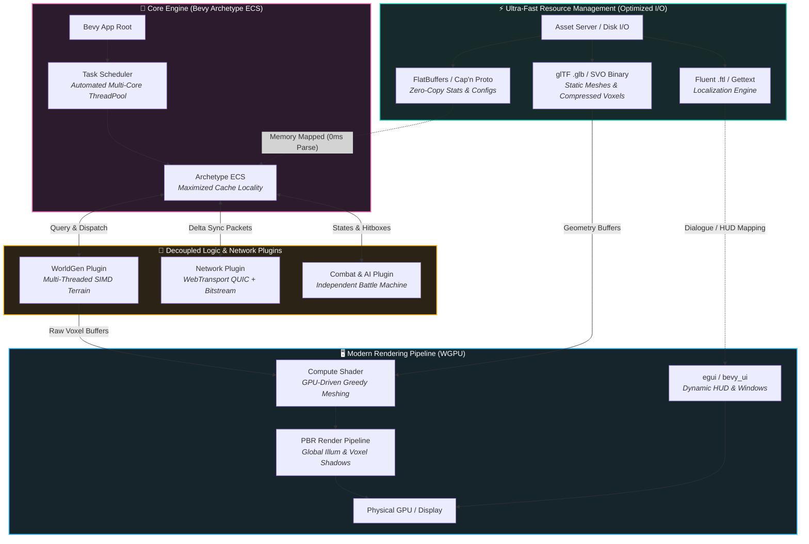

<div align="center">


<a href="#-getting-started">
  
</a>

<br/>

[](https://www.rust-lang.org/)
[](https://bevyengine.org/)
[](https://wgpu.rs/)

[](https://www.gnu.org/licenses/gpl-3.0)
[](#)
[](#-roadmap)
[](#-contributing)

<p align="center">
  <b>Redstoric</b> is an open-source, high-performance Voxel RPG engine built from the ground up in Rust. Designed to eliminate the CPU bottlenecks of legacy voxel engines, Redstoric combines <b>Bevy Archetype ECS</b>, <b>Zero-Copy FlatBuffers I/O</b>, <b>GPU-driven Compute Meshing</b>, and <b>QUIC WebTransport</b> networking.
</p>

<table>
  <tr>
    <td align="center"><h3>🦀</h3><b>Pure Rust</b><br/><sub>2024 Edition</sub></td>
    <td align="center"><h3>🧬</h3><b>Archetype ECS</b><br/><sub>Cache-friendly by design</sub></td>
    <td align="center"><h3>🎮</h3><b>GPU Meshing</b><br/><sub>Compute shader driven</sub></td>
    <td align="center"><h3>🌐</h3><b>QUIC Netcode</b><br/><sub>WebTransport + deltas</sub></td>
  </tr>
</table>

<br/>

[Architecture](#-system-architecture) •
[Features](#-key-features) •
[Quick Start](#-getting-started) •
[Workspace](#-workspace-structure) •
[Roadmap](#-roadmap) •
[Contributing](#-contributing)

</div>

---

## 📖 Table of Contents

<details>
<summary><b>Click to expand</b></summary>

- [🔥 Why Redstoric?](#-why-redstoric)
- [📐 System Architecture](#-system-architecture)
- [✨ Key Features](#-key-features)
- [🧰 Tech Stack](#-tech-stack)
- [🚀 Getting Started](#-getting-started)
- [🗂️ Workspace Structure](#️-workspace-structure)
- [🗺️ Roadmap](#️-roadmap)
- [🤝 Contributing](#-contributing)
- [📜 License](#-license)
- [🙏 Acknowledgments](#-acknowledgments)

</details>

---

## 🔥 Why Redstoric?

Legacy voxel engines tend to hit the same walls: single-threaded chunk meshing, heavy object graphs, slow config parsing, and chatty TCP-style networking. Redstoric attacks each of these at the architecture level.

| 🐌 The Legacy Bottleneck | ⚡ The Redstoric Answer |
| :--- | :--- |
| Chunk meshing on the CPU | **GPU compute shader** greedy meshing |
| Object-oriented entity graphs, pointer chasing | **Bevy Archetype ECS** with maximized cache locality |
| Parsing JSON/XML configs at load time | **Zero-copy FlatBuffers**, memory-mapped, no parse step |
| Head-of-line blocking over TCP | **QUIC / WebTransport** with delta-sync packets |
| Single-threaded world generation | **Multi-threaded SIMD** terrain generation |
| Hard-wired, monolithic game logic | **Decoupled plugins** (WorldGen, Network, Combat & AI) |

---

## 📐 System Architecture

Redstoric is engineered around strict **Decoupled Architecture** and **Data-Oriented Design (DOD)**. The architecture prioritizes maximum cache locality, zero-allocation resource streaming, and offloading heavy compute pipelines directly to the GPU.



### 🧱 The Four Layers at a Glance

| Layer | Role | Key Tech |
| :---: | :--- | :--- |
| 🟦 **I/O** | Streams assets with zero allocations; configs are memory-mapped rather than parsed | FlatBuffers, glTF/SVO, Fluent |
| 🟪 **Core** | Owns all game state in cache-friendly archetype tables and schedules systems across cores | Bevy ECS, Task Scheduler |
| 🟨 **Logic & Network** | Independent plugins that talk to the ECS only through queries and events | WorldGen, WebTransport, Combat/AI |
| 🟦 **Render** | Turns raw voxel buffers into meshes on the GPU, then shades and presents them | WGPU, Compute, PBR, egui |

> [!TIP]
> Because every gameplay system is a plugin, you can disable or swap any of them (for example, running a headless server with only `WorldGen` + `Network`) without touching the core.

---

## ✨ Key Features

<table>
  <tr>
    <td width="50%" valign="top">
      <h3>⚡ Zero-Copy Resource I/O</h3>
      Stats, items, and configs live in <b>FlatBuffers</b> and are memory-mapped straight into the ECS. No deserialization, no allocation spikes, <b>0 ms parse</b>.
    </td>
    <td width="50%" valign="top">
      <h3>🖥️ GPU-Driven Greedy Meshing</h3>
      Chunk meshing runs in <b>compute shaders</b> via WGPU, freeing the CPU for gameplay, AI, and networking.
    </td>
  </tr>
  <tr>
    <td width="50%" valign="top">
      <h3>🧬 Archetype ECS Core</h3>
      Built on <b>Bevy</b> for tightly packed component storage and automatic multi-core scheduling.
    </td>
    <td width="50%" valign="top">
      <h3>🌍 SIMD World Generation</h3>
      A dedicated <b>WorldGen plugin</b> generates terrain across many threads using SIMD-accelerated noise.
    </td>
  </tr>
  <tr>
    <td width="50%" valign="top">
      <h3>🌐 QUIC WebTransport Networking</h3>
      Low-latency, multiplexed transport with <b>delta-sync packets</b> and compact bitstream encoding. No head-of-line blocking.
    </td>
    <td width="50%" valign="top">
      <h3>⚔️ Independent Combat & AI</h3>
      A self-contained <b>battle machine</b> handles states and hitboxes, decoupled from rendering and networking.
    </td>
  </tr>
  <tr>
    <td width="50%" valign="top">
      <h3>🎨 Modern PBR Rendering</h3>
      Physically-based shading with <b>global illumination</b> and <b>voxel shadows</b>, plus compressed SVO/glTF asset support.
    </td>
    <td width="50%" valign="top">
      <h3>🈯 First-Class Localization</h3>
      Dialogue and HUD text are driven by <b>Fluent (.ftl)</b> / Gettext, so translating your game never touches code.
    </td>
  </tr>
</table>

---

## 🧰 Tech Stack

| Domain | Technology |
| :--- | :--- |
| 🦀 **Language** | Rust (2024 Edition) |
| 🧠 **Engine / ECS** | [Bevy 0.20](https://bevyengine.org/) |
| 🎮 **Graphics** | [WGPU](https://wgpu.rs/) + compute shaders |
| 📦 **Serialization** | FlatBuffers / Cap'n Proto |
| 🧊 **Assets** | glTF `.glb`, SVO binary |
| 🌐 **Networking** | WebTransport over QUIC |
| 🈯 **Localization** | Fluent `.ftl` / Gettext |
| 🪟 **UI** | `egui` / `bevy_ui` |

---

## 🚀 Getting Started

### 📋 Prerequisites

- 🦀 **Rust** 1.85+ (latest stable recommended), install via [rustup](https://rustup.rs/)
- 🎮 A GPU with **Vulkan**, **Metal**, or **DirectX 12** support
- 🔧 **Git**

### ⚙️ Build & Run

```bash
# 1. Clone the repository
git clone https://github.com/horashidev-netizen/redstoric.git
cd redstoric

# 2. Run in release mode (recommended for voxel workloads)
cargo run --release
```

> [!NOTE]
> Debug builds work but are noticeably slower for world generation and meshing. Use `--release` when testing performance.

<details>
<summary>🐧 <b>Linux: system dependencies</b></summary>

<br/>

On Debian/Ubuntu, install the libraries Bevy needs:

```bash
sudo apt-get install g++ pkg-config libx11-dev libasound2-dev libudev-dev \
                     libwayland-dev libxkbcommon-dev
```

For other distributions, see the [Bevy Linux dependencies guide](https://github.com/bevyengine/bevy/blob/main/docs/linux_dependencies.md).

</details>

<details>
<summary>🍎 <b>macOS notes</b></summary>

<br/>

Rendering uses **Metal** through WGPU. Install the Xcode command line tools if you haven't already:

```bash
xcode-select --install
```

</details>

<details>
<summary>🪟 <b>Windows notes</b></summary>

<br/>

Install the **Visual Studio C++ Build Tools**. Rendering uses **DirectX 12** or **Vulkan** through WGPU.

</details>

> [!WARNING]
> Redstoric is in **early development**. APIs, file formats, and the network protocol may change without notice.

---

## 🗂️ Workspace Structure

> [!IMPORTANT]
> The tree below is a suggested layout based on the architecture diagram. Rename the crates to match your actual workspace.

```text
redstoric/
├── 📁 crates/
│   ├── 🧠 redstoric_core/       # App root, scheduler, shared ECS components
│   ├── ⚡ redstoric_assets/     # FlatBuffers / SVO / glTF / Fluent loaders
│   ├── 🌍 redstoric_worldgen/   # Multi-threaded SIMD terrain generation
│   ├── 🌐 redstoric_network/    # WebTransport + QUIC, delta sync
│   ├── ⚔️ redstoric_combat/     # Combat state machine, hitboxes, AI
│   └── 🖥️ redstoric_render/     # Compute meshing, PBR pipeline, UI
├── 📁 assets/                   # Game data, models, shaders, localization
├── 📁 schemas/                  # FlatBuffers `.fbs` definitions
├── 📁 docs/                     # Design docs and guides
├── 📄 Cargo.toml                # Workspace manifest
└── 📄 README.md
```

---

## 🗺️ Roadmap

> [!IMPORTANT]
> Placeholder milestones. Tick the boxes and adjust the phases to reflect your real progress.

### 🏗️ Phase 1: Foundation
- [ ] Bevy app skeleton and plugin architecture
- [ ] FlatBuffers asset pipeline with memory-mapped loading
- [ ] Basic chunk data structures

### 🖥️ Phase 2: Rendering
- [ ] GPU compute greedy meshing
- [ ] PBR pipeline with voxel shadows
- [ ] SVO / glTF asset support
- [ ] Global illumination

### 🌍 Phase 3: World & Gameplay
- [ ] SIMD multi-threaded terrain generation
- [ ] Combat & AI plugin
- [ ] HUD / UI with Fluent localization

### 🌐 Phase 4: Multiplayer
- [ ] WebTransport / QUIC server and client
- [ ] Delta-sync replication
- [ ] Dedicated headless server mode

### 🚢 Phase 5: Release
- [ ] Modding / data-driven content API
- [ ] Documentation site
- [ ] First stable release

---

## 🤝 Contributing

Contributions of all kinds are welcome: code, docs, bug reports, and ideas. 💖

1. 🍴 **Fork** the repository
2. 🌿 **Create** a feature branch: `git checkout -b feat/amazing-feature`
3. 🔧 **Make** your changes and run the checks:
   ```bash
   cargo fmt --all
   cargo clippy --workspace --all-targets -- -D warnings
   cargo test --workspace
   ```
4. 💾 **Commit** with a clear message: `git commit -m "feat: add amazing feature"`
5. 📤 **Push** your branch: `git push origin feat/amazing-feature`
6. 🔀 **Open a Pull Request**

> [!TIP]
> Not sure where to start? Look for issues labeled `good first issue`, or open a discussion to pitch an idea.

---

## 📜 License

Distributed under the **GNU General Public License v3.0**. See [`LICENSE`](LICENSE) for details.

---

## 🙏 Acknowledgments

Redstoric stands on the shoulders of giants:

- [**Bevy**](https://bevyengine.org/): the data-driven game engine at our core
- [**wgpu**](https://wgpu.rs/): safe, portable GPU access
- [**FlatBuffers**](https://flatbuffers.dev/): zero-copy serialization
- [**Fluent**](https://projectfluent.org/): natural-sounding localization
- [**egui**](https://github.com/emilk/egui): immediate-mode UI

---

<div align="center">

**⚔️ Forged in Rust. Powered by the GPU. ⚔️**

<sub>If you like Redstoric, consider giving it a ⭐. It helps a lot!</sub>


</div>