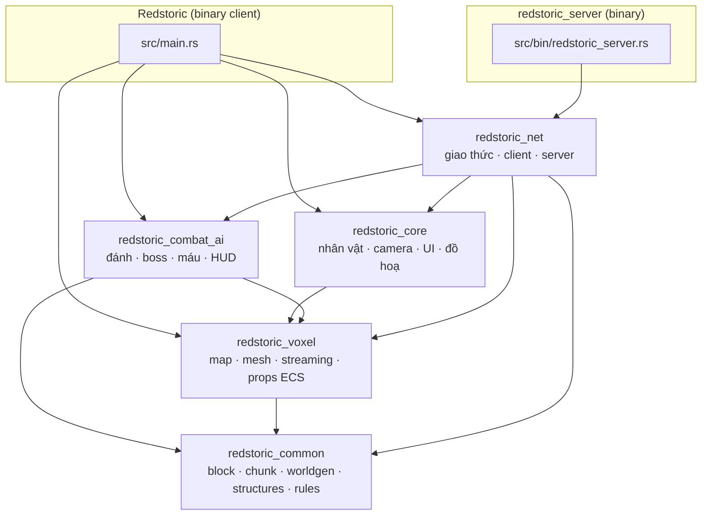
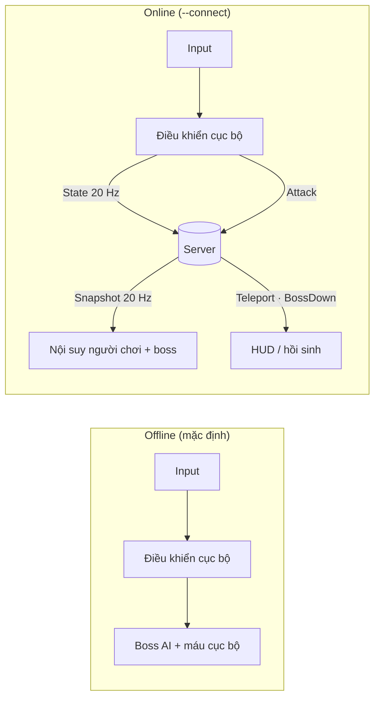
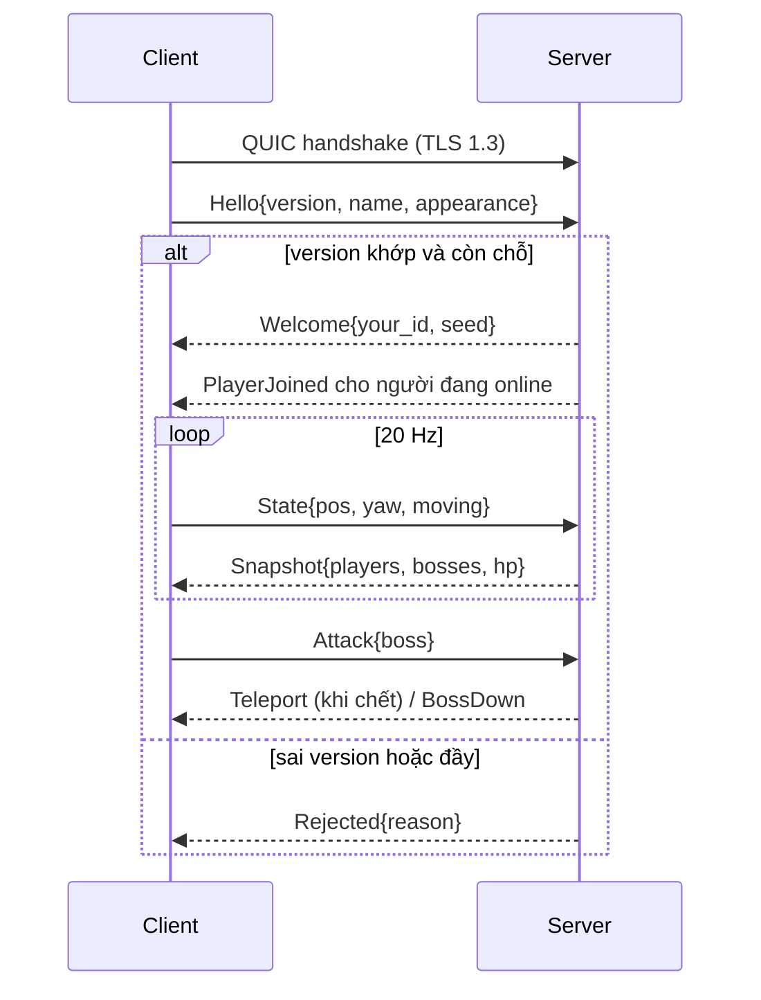

# Redstoric

Redstoric là một game voxel hành động viết bằng **Rust** và **Bevy 0.20**. Thế giới
được sinh thủ tục theo chunk, có làng, đấu trường boss, nhân vật tuỳ biến, combat
cận chiến và chế độ nhiều người chơi chạy trên **QUIC** với server có quyền quyết
định (authoritative) theo kiểu game co-op online.

> Dự án đang phát triển tích cực. Cấu trúc crate, giao thức mạng và định dạng dữ
> liệu có thể thay đổi giữa các phiên bản. Giao thức mạng hiện ở `PROTOCOL_VERSION = 1`.

---

## Mục lục

1. [Tính năng](#tính-năng)
2. [Bắt đầu nhanh](#bắt-đầu-nhanh)
3. [Điều khiển](#điều-khiển)
4. [Kiến trúc tổng quan](#kiến-trúc-tổng-quan)
5. [Hệ thống thế giới](#hệ-thống-thế-giới)
6. [Hệ thống chiến đấu và boss](#hệ-thống-chiến-đấu-và-boss)
7. [Nhân vật và hoạt ảnh](#nhân-vật-và-hoạt-ảnh)
8. [Đồ hoạ và hiệu năng](#đồ-hoạ-và-hiệu-năng)
9. [Hệ thống mạng](#hệ-thống-mạng)
10. [Cấu trúc thư mục](#cấu-trúc-thư-mục)
11. [Asset và công cụ](#asset-và-công-cụ)
12. [Cấu hình và file dữ liệu](#cấu-hình-và-file-dữ-liệu)
13. [Phát triển](#phát-triển)
14. [Hạn chế đã biết](#hạn-chế-đã-biết)
15. [Lộ trình](#lộ-trình)
16. [Giấy phép](#giấy-phép)

---

## Tính năng

| Nhóm | Nội dung |
| --- | --- |
| Thế giới | Chunk `16×64×16`, sinh bằng nhiều lớp noise (độ cao, khí hậu, hang động), 5 biome: Ocean, Desert, Savanna, Forest, SnowMountain |
| Cấu trúc | Làng (nhà, quảng trường, ruộng lúa/lúa mì/vườn), đấu trường boss, cây kiểu Veloren, hệ thống sprite trang trí đọc từ thư mục asset |
| Streaming | Sinh chunk trên worker thread, tải/dỡ theo khoảng cách người chơi, mesh có màu theo khối và ambient occlusion |
| Nhân vật | Dựng từ các mảnh model, trình tạo nhân vật (F7), hoạt ảnh đi bộ theo thủ tục |
| Chiến đấu | Đánh kiếm, kiểm tra trúng theo tầm và góc, knockback, hiệu ứng chớp đỏ, boss có máy trạng thái, HUD |
| Multiplayer | Server chuyên dụng (dedicated), tối đa 8 người, boss và máu do server quyết định, đồng bộ snapshot 20 Hz |
| Dân làng | NPC theo nghề (nông dân, thợ rèn, thương nhân...), bảng tên trên đầu, gợi ý `E Talk / T Trade`, hội thoại và cửa hàng tối giản |
| Cảnh quan | Hàng rào và cổng quanh ruộng, đèn đường, cổ thụ khổng lồ, khinh khí cầu bằng khối bay trên làng |
| Giao diện | Minimap kiểu Veloren (tên địa danh, N/E/S/W, thu phóng), bộ đếm FPS, menu đồ hoạ với chế độ chất lượng tự động |
| Công cụ | `batch_vox`: chuyển `.vox` sang `.glb` |

## Bắt đầu nhanh

### Yêu cầu

- Rust stable hỗ trợ **Edition 2024**
- GPU/driver tương thích với backend WGPU của Bevy (Vulkan, DX12 hoặc Metal)
- Linux cần thêm thư viện hệ thống của Bevy (ALSA, udev, Wayland/X11); xem hướng
  dẫn dependency chính thức của Bevy

### Chơi một mình

```bash
cargo run --release
```

Build debug đã đặt `opt-level = 1`, nhưng `--release` vẫn nên dùng khi kiểm tra
streaming chunk và sinh mesh.

### Chơi nhiều người

Chạy server (cửa sổ terminal thứ nhất):

```bash
cargo run --release --bin redstoric_server -- --port 6000
```

Chạy client và kết nối (mỗi người chơi một terminal):

```bash
cargo run --release --bin Redstoric -- --connect 127.0.0.1:6000 --name Tam
```

Kết nối qua LAN/Internet: thay `127.0.0.1` bằng IP máy chạy server và mở
**UDP 6000** trên firewall/router (QUIC chạy trên UDP).

Có thể dùng biến môi trường thay cho tham số dòng lệnh:

| Tham số | Biến môi trường | Ý nghĩa | Mặc định |
| --- | --- | --- | --- |
| `--connect <ip[:port]>` | `REDSTORIC_SERVER` | Địa chỉ server; không đặt thì chơi offline | không |
| `--name <tên>` | `REDSTORIC_NAME` | Tên hiển thị (tối đa 20 ký tự) | tự sinh |
| `--port <port>` (server) | | Cổng lắng nghe | `6000` |

## Điều khiển

| Thao tác | Phím |
| --- | --- |
| Di chuyển | `W` `A` `S` `D` hoặc phím mũi tên |
| Nhảy | `Space` |
| Xoay camera | Giữ chuột phải + di chuyển chuột |
| Zoom | Con lăn chuột |
| Đánh | Chuột trái |
| Nói chuyện / giao dịch với dân làng (đứng gần) | `E` / `T` (mua bằng `1`-`4`, đóng bằng `Esc`) |
| Thu phóng minimap | Nút `-` `+` trên minimap hoặc phím `-` `=` |
| Trình tạo nhân vật | `F7` |
| Bật/tắt FPS | `F3` |
| Đổi chế độ chất lượng | `F4` (Auto → Low → Medium → High → Ultra) |
| Menu đồ hoạ | `F10` |
| Tua nhanh 1 giờ (ngày/đêm) | `F8` |
| Bật/tắt mưa | `F6` |
| Chạy nước rút | giữ `Shift` |
| Nhảy / bơi lên | `Space` |
| Lặn xuống | `Ctrl` (khi ở dưới nước) |
| Leo vách | đi thẳng vào vách (có giới hạn sức bám) |

## Động vật hoang dã

Heo, thỏ, hươu và sói (model lấy từ `assets/placeholders/glb/npc/`) sinh ra theo cách Veloren làm:

- **Spawn** (`redstoric_common::fauna`): mỗi chunk có xác suất chứa một bầy tuỳ vùng sinh thái, giờ trong ngày (sói chỉ ra buổi chiều tối và ban đêm) và cỡ bầy. Thú xuất hiện khi chunk vào tầm 5 chunk và bị xoá khi đi quá 7 chunk. `REDSTORIC_NO_FAUNA=1` tắt hẳn.
- **AI** (`redstoric_combat_ai::fauna`): lang thang bằng `bearing` random-walk kéo về nhà (30 tick/giây), dừng trước vách, vực và nước, thỉnh thoảng cúi gặm cỏ. Nhận biết người chơi qua tầm nhìn/nghe và thanh `awareness`, rồi Alert → chạy trốn (heo, thỏ, hươu) hoặc đuổi cắn (sói, cả bầy cùng báo động, bỏ chạy khi máu thấp).
- **Hoạt ảnh**: chu kỳ chân, nhún thân, cúi đầu, vẫy đuôi theo `quadruped_small/medium` của Veloren. Bộ khung `fauna/layout.rs` sinh tự động từ manifest của Veloren.
- Thú chỉ có ở phía client và không đồng bộ qua mạng. Khi chơi online, sói không gây sát thương.

## Thời tiết và mặt nước

- **Mưa** (`redstoric_core::weather`): hạt mưa rơi trong hình trụ quanh camera, dừng lại khi chạm khối (lá cây che được mưa), cơn mưa tự đến và tạnh theo lịch ngẫu nhiên, trời xám dần và nắng yếu đi. `F6` bật/tắt ngay, `REDSTORIC_RAIN=1` bắt đầu trong mưa.
- **Mặt nước**: dựng thành mesh riêng với vật liệu bóng, trong suốt; màu pha theo màu bầu trời, normal map gợn sóng trượt liên tục (nhanh hơn khi mưa). Đây là phản chiếu giả theo màu trời, chưa phản chiếu thật cảnh vật.
- **Gợn sóng**: vòng sóng lan ra khi hạt mưa rơi xuống nước và khi người chơi lội hoặc bơi.
- **Cá**: Clownfish và Piranha bơi thành đàn ở hồ, sông (`redstoric_combat_ai::fauna::fish`), tránh bờ và lao đi khi người chơi lại gần. Mô hình lấy từ `fish_small` của Veloren.

## Kiến trúc tổng quan

Workspace gồm 5 crate và 2 binary. Lõi mô phỏng nằm ở `redstoric_common` (không phụ thuộc đồ hoạ) và được client lẫn server dùng chung, theo tinh thần crate `common` của Veloren:



| Crate | Trách nhiệm |
| --- | --- |
| `redstoric_common` | **Lõi dùng chung, không đồ hoạ**: khối, chunk, sinh thế giới, cấu trúc, danh mục sprite, dữ liệu prop, `rules` (hằng số cân bằng boss/người chơi, nguồn sự thật duy nhất cho offline và server) |
| `redstoric_core` | Điều khiển nhân vật, camera orbit, trình tạo nhân vật, hoạt ảnh, minimap, FPS, hệ thống đồ hoạ, material voxel |
| `redstoric_voxel` | Phía client: bản đồ voxel, dựng mesh, streaming chunk, spawn prop. Re-export `redstoric_common` nên đường dẫn cũ vẫn dùng được |
| `redstoric_combat_ai` | Tấn công, kiểm tra trúng, máu người chơi, boss AI, hiệu ứng, HUD, bù nhìn tập đánh |
| `redstoric_net` | Giao thức `ClientMsg`/`ServerMsg`, plugin client, plugin server, đồng bộ trạng thái |

### Luồng chạy hai chế độ



Khi kết nối thành công, tài nguyên `OnlineMode(true)` tắt `boss_ai_system` và
`player_health_system` cục bộ. Đòn đánh trúng boss không gây sát thương tại
client mà được gom vào `PendingBossHits` rồi gửi lên server.

## Hệ thống thế giới

### Hòn đảo hữu hạn

Thế giới là hình vuông `2 * WORLD_HALF` (mặc định 2048 khối) với một hòn đảo ở giữa, bao quanh bởi biển.
Người chơi bị giữ trong biên. Núi tuyết ở phía tây, sa mạc ở phía đông, đồng bằng và rừng ở giữa,
cùng hồ, sông và bờ biển lồi lõm. Các hằng số hình dạng nằm trong `generation.rs`
(`island_value`, `get_surface_height`, `get_climate`).

### Tải trước toàn bộ thế giới

Vì thế giới hữu hạn, lúc vào game toàn bộ chunk của hòn đảo được sinh một lần trên các luồng
worker, kèm màn hình tải có thanh tiến độ (`redstoric_voxel/src/preload.rs`). Dữ liệu khối và
danh sách prop được giữ trong bộ nhớ (khoảng 270 MB với `WORLD_HALF = 1024`), nên khi chơi:

- không còn sinh địa hình, cây, làng giữa chừng, hết giật khi chạy sang vùng mới;
- chunk ở xa chỉ bị dỡ mesh chứ không mất dữ liệu; va chạm và minimap đúng trên cả đảo;
- chỉ phần trong tầm nhìn được dựng mesh và spawn (vẽ cả đảo cùng lúc sẽ làm FPS tụt).

Đặt `REDSTORIC_NO_PRELOAD=1` để tắt và quay lại sinh theo yêu cầu (tiện khi phát triển).

### Chunk và streaming

- Kích thước chunk: `16 × 64 × 16` (`CHUNK_SIZE_X/Y/Z`).
- Chunk được sinh bất đồng bộ trên worker thread rồi dựng mesh.
- Bán kính tải là 7 chunk; chunk bị dỡ khỏi scene khi vượt 9 chunk.
- Mesh lấy các mặt voxel lộ ra, tô màu theo loại khối, có ambient occlusion ở góc.

### Sinh địa hình

`WorldGenerator` là hàm thuần theo `WORLD_SEED` (hiện cố định `1337`), gồm:

- `surface`: độ cao địa hình từ nhiều tầng noise.
- `climate`: nhiệt độ và độ ẩm → biome (`Ocean`, `Desert`, `Savanna`, `Forest`, `SnowMountain`).
- `cave`: hang động.

Vì sinh thế giới là deterministic, server không cần tải chunk vẫn tìm được các
đấu trường boss bằng `WorldGenerator::sites_in_area`.

### Cấu trúc (Sites)

Thế giới chia thành các vùng; mỗi vùng có thể chứa một `Site`:

| Loại | Mô tả |
| --- | --- |
| `Village` | Quảng trường với trạm và đèn, nhà có nội thất, ruộng lúa/lúa mì/vườn kèm bù nhìn và rơm |
| `BossArena` | Đấu trường san phẳng, có phong ấn, nến, xương và mộ |

Địa hình quanh site được san phẳng và hoà trộn trong dải `BLEND = 6` khối.

### Props và sprite

- Cây sinh theo phong cách Veloren; prop được spawn theo chunk.
- Hệ thống sprite quét thư mục `assets/placeholders/glb/sprite`, dựng catalog tự
  động và đọc độ lệch chân từ accessor `min` của file glb.
- Bảng rải sprite theo biome: grassland, forest, savanna, desert, snow, beach.
  Thêm file glb mới vào thư mục sprite là đủ để hệ thống nhận ra.

## Hệ thống chiến đấu và boss

- **Đòn đánh**: chuột trái, kiểm tra trúng theo khoảng cách và góc nhìn, knockback,
  hiệu ứng chớp đỏ khi trúng.
- **Boss**: máy trạng thái `Idle → Chase → Windup → Recover → Dying`, giới hạn di
  chuyển trong bán kính 13 quanh tâm đấu trường, hồi sinh sau khi bị hạ.
- **Bù nhìn tập đánh**: 100 máu, mỗi đòn mặc định gây 25 sát thương trong tầm 2.8.
- **HUD**: thanh máu người chơi và boss.

Khi online, toàn bộ luật boss và máu chạy trên server.

## Nhân vật và hoạt ảnh

- Nhân vật dựng từ các mảnh model và ghép theo phân cấp; `clean_character_glb_hierarchy`
  chuẩn hoá cây node sau khi nạp glb.
- Trình tạo nhân vật (`F7`) lưu lựa chọn vào `character_appearance.json`.
- Hoạt ảnh đi bộ được tạo theo thủ tục (`biped_walk_animation_system`,
  `character_procedural_animation`), không cần clip dựng sẵn.
- Khi online, `appearance` của bạn được gửi cho server và phát cho người khác.

## Đồ hoạ và hiệu năng

- Chế độ chất lượng `Auto / Low / Medium / High / Ultra`; chế độ Auto tự điều
  chỉnh theo FPS. Cài đặt lưu vào `graphics_settings.json`.
- Menu đồ hoạ (`F10`), bộ đếm FPS (`F3`), minimap.
- Material voxel riêng và shader trong `assets/placeholders` / `assets/shaders`.

## Hệ thống mạng

### Tổng quan

- Thư viện: [`bevy_quinnet`](https://crates.io/crates/bevy_quinnet) **0.22** (dành cho Bevy 0.20), chạy trên Quinn/QUIC, TLS 1.3, tuần tự hoá bằng `bincode`.
- Mô hình: **server chuyên dụng có quyền quyết định**; client chỉ gửi ý định và vị trí, nhận trạng thái chuẩn.
- Giới hạn: tối đa **8** người chơi.

### Kênh

| ID | Kiểu | Dùng cho |
| --- | --- | --- |
| 0 | `OrderedReliable` | Hello, Welcome, Rejected, PlayerJoined/Left, Appearance, Teleport, BossDown, Attack |
| 1 | `Unreliable` | `State` của người chơi và `Snapshot` của server (20 Hz) |

### Thông điệp (`crates/redstoric_net/src/protocol.rs`)

```text
ClientMsg: Hello{version, name, appearance} | Appearance(String)
         | State(PlayerState{pos, yaw, moving}) | Attack{boss:[i32;2]}

ServerMsg: Welcome{your_id, seed} | Rejected{reason}
         | PlayerJoined{id, name, appearance} | PlayerLeft{id}
         | PlayerAppearance{id, appearance}
         | Teleport{pos} | BossDown{boss}
         | Snapshot{players, bosses, hp, max_hp}
```

### Trình tự kết nối



### Phân chia trách nhiệm

| Thành phần | Server | Client |
| --- | --- | --- |
| Máu người chơi | Sở hữu, trừ máu | Hiển thị |
| Boss (HP, AI, trạng thái) | Sở hữu, mô phỏng trên mặt phẳng XZ | Nội suy x/z, tự tính Y từ địa hình |
| Vị trí người chơi | Kiểm tra tốc độ tối đa | Sở hữu và gửi lên |
| Đòn đánh | Kiểm tra tầm (7.0) và hồi chiêu (0.3 s) | Gửi ý định `Attack` |
| Thế giới | Sinh từ `WORLD_SEED` để tìm đấu trường | Sinh và dựng mesh cục bộ |

### Bảo mật hiện tại

- Kênh được mã hoá bằng TLS 1.3. Server tạo chứng chỉ tự ký `server_cert.pem` / `server_key.pem` ở lần chạy đầu (đã nằm trong `.gitignore`).
- Client dùng `SkipVerification`: mã hoá được nhưng **không xác thực server**, nên chưa chống được tấn công man-in-the-middle. Đây là cấu hình dành cho phát triển và LAN.
- Server giới hạn kích thước appearance (1024 byte) và độ dài tên (20 ký tự), kiểm tra phiên bản giao thức.

## Cấu trúc thư mục

```text
.
├── assets/
│   ├── localization/            # Chuỗi dịch
│   ├── placeholders/
│   │   ├── glb/                 # Model glb (kèm glb/sprite cho sprite trang trí)
│   │   └── voxygen/voxel/       # Nguồn .vox
│   ├── shaders/
│   └── voxygen/                 # Asset tham khảo kiểu Veloren
├── crates/
│   ├── redstoric_common/        # Lõi dùng chung: block, chunk, worldgen, structures, sprites, rules
│   ├── redstoric_core/          # Nhân vật, camera, UI, đồ hoạ
│   ├── redstoric_voxel/         # Client: map, mesh, streaming, props ECS
│   ├── redstoric_combat_ai/     # Combat, boss, HUD
│   └── redstoric_net/           # Giao thức, client, server
├── src/
│   ├── main.rs                  # App client
│   └── bin/
│       ├── batch_vox.rs         # Công cụ .vox → .glb
│       └── redstoric_server.rs  # Server chuyên dụng
├── character_appearance.json    # Ngoại hình đã lưu
├── graphics_settings.json       # Cài đặt đồ hoạ đã lưu
└── Cargo.toml                   # Workspace
```

## Asset và công cụ

### Chuyển `.vox` sang `.glb`

```bash
cargo run --bin batch_vox
```

Quét `assets/placeholders/voxygen/voxel/`, ghi `.glb` vào `assets/placeholders/glb/`.
Tool xử lý model đầu tiên trong mỗi file `.vox`, bỏ mặt bị che, giữ màu palette.

### Thêm sprite trang trí

1. Đặt file `.glb` vào `assets/placeholders/glb/sprite/` (có thể chia thư mục con theo nhóm).
2. Chạy lại game; catalog tự quét, tự lấy độ lệch chân.
3. Muốn sprite xuất hiện ở biome nào thì thêm tên vào bảng tương ứng trong `crates/redstoric_common/src/sprites.rs`.

## Cấu hình và file dữ liệu

| File | Tạo bởi | Nội dung |
| --- | --- | --- |
| `character_appearance.json` | Trình tạo nhân vật (F7) | Ngoại hình nhân vật |
| `graphics_settings.json` | Menu đồ hoạ (F10/F4) | Chế độ chất lượng và tuỳ chọn |
| `server_cert.pem`, `server_key.pem` | Server, lần chạy đầu | Chứng chỉ TLS tự ký (không commit) |

## Phát triển

```bash
cargo fmt --all -- --check
cargo check --workspace
cargo test --workspace
```

Quy ước làm việc:

- Một thay đổi, một mục đích; mô tả rõ hành vi trong pull request.
- Giữ logic không phụ thuộc đồ hoạ (luật boss, worldgen) tách khỏi system Bevy để dễ chia sẻ giữa client và server.
- Mở issue trước với thay đổi lớn.
- Xoá các file `*.bak*` còn sót trước khi commit.

## Hạn chế đã biết

- Người chơi khác đang hiển thị bằng hình hộp tạm; ngoại hình được truyền nhưng chưa render.
- Chưa xác thực server (`SkipVerification`).
- Boss bị giới hạn bán kính 13 vì server không giữ voxel; chưa có va chạm địa hình phía server.
- `WORLD_SEED` cố định trong code, chưa cấu hình được.
- Boss đã hạ chỉ được nhớ trong một phiên server, chưa lưu xuống đĩa.
- Chưa có menu nhập địa chỉ server; dùng tham số dòng lệnh.
- Hằng số boss đã dùng chung qua `redstoric_common::rules`, nhưng máy trạng thái boss vẫn được cài đặt hai lần (`combat_ai/boss.rs` cho offline, `redstoric_net/server.rs` cho server).
- Chưa có lưu thế giới, chỉnh sửa khối đồng bộ, hay lag compensation.

## Lộ trình

1. ~~Tách `redstoric_common`~~ (xong): block, chunk, `WorldGenerator`, structures, sprites, hằng số luật chơi.
2. Gộp máy trạng thái boss thành hàm thuần trong `redstoric_common` dùng chung cho client và server (hằng số đã gộp).
3. Server nhúng cho chế độ chơi đơn (cùng một đường code với multiplayer).
4. Combat dựa trên sự kiện thay vì sửa máu trực tiếp.
5. Dữ liệu dạng file (RON/JSON): block, prop, boss, loot.
6. Lưu thế giới, đồng bộ chỉnh sửa khối, NPC dạng mô phỏng thế giới.
7. Đồng bộ delta theo vùng quan tâm, lịch sử vị trí cho lag compensation, đo thời gian tick.
8. Xác thực server bằng chứng chỉ thật, hiển thị nhân vật từ xa với ngoại hình đầy đủ.

## Giấy phép

Phát hành theo **GNU General Public License v3.0**. Xem [LICENSE](LICENSE).

## Hậu kỳ & màu sắc
- Camera dùng HDR + Bloom + tonemapping TonyMcMapface (đèn, mặt trời loá nhẹ).
- Màu khối biến thiên theo vùng (nhiễu giá trị theo toạ độ thế giới): cỏ/lá ngả vàng–xanh, cát/đất/đá sáng tối theo mảng.

## Âm thanh
- Dùng bộ âm thanh Veloren (`assets/placeholders/voxygen/audio`): nhạc nền theo giờ/mưa, gió, mưa, suối gần nước, chim ban ngày, dế/cú/ếch ban đêm, sấm, bước chân theo loại khối, nhảy/đáp/bơi, đòn đánh, tiếng thú. F10 tắt/bật tiếng.

- Chém kiếm: cả cánh tay phải vung (giơ cao -> chém chéo xuống), có vệt chém sáng dạng cung (`animation.rs`).

## Vũ khí theo chức nghiệp
Mỗi người chơi chỉ có **một** chức nghiệp: lần đầu vào game menu nhân vật (F7) tự mở, chọn chức nghiệp (hàng `Class`) + ngoại hình rồi bấm **Confirm** để khoá chức nghiệp. Sau đó vẫn đổi được ngoại hình bằng F7. Muốn chọn lại chức nghiệp: xoá `character_appearance.json`. Chuột trái để đánh. Model lấy từ `assets/placeholders/glb/weapon`, vị trí cầm theo `biped_weapon_manifest.ron` của Veloren.

| # | Chức nghiệp | Cách đánh |
|---|---|---|
| 1 | Kiếm sĩ (kiếm) | Chém chéo nhanh, hình quạt phía trước, có vệt chém |
| 2 | Chiến binh rìu | Quét một vòng quanh người, trúng mọi mục tiêu trong tầm |
| 3 | Chiến binh búa | Nện xuống chậm, sát thương lớn, sóng xung kích hình tròn |
| 4 | Cung thủ (cung) | Bắn tên (rơi theo trọng lực), tự ngắm mục tiêu trước mặt |
| 5 | Pháp sư lửa (trượng) | Cầu lửa nổ lan bán kính 3.5 khối |
| 6 | Mục sư (quyền trượng) | Tia xanh gây sát thương nhẹ, mỗi lần trúng hồi máu cho người chơi |

Chỉ số từng vũ khí nằm ở bảng `WEAPONS` trong `crates/redstoric_core/src/weapons.rs`.

## Chạy trên điện thoại (Android)

1. Cài một lần: `rustup target add aarch64-linux-android`, `cargo install cargo-apk`, Android SDK + NDK (đặt `ANDROID_HOME`, `ANDROID_NDK_ROOT`).
2. Tạo manifest nhúng (APK không quét được thư mục): `cargo run --bin dump_manifests`.
3. Gói asset nhẹ (vài chục MB thay vì 946 MB): `python tools/pack_mobile_assets.py` (chạy trực tiếp trên ổ đĩa máy, tạo `target/mobile_assets`).
4. Build: `REDSTORIC_DEFAULT_SERVER=IP_VPS:6000 cargo apk build --release` (PowerShell: `$env:REDSTORIC_DEFAULT_SERVER="IP:6000"`). Bỏ biến này nếu chỉ chơi offline.
5. Cài: `cargo apk run --release` hoặc `adb install target/release/apk/Redstoric.apk`.

Điều khiển cảm ứng: nửa trái = joystick, nửa phải = xoay camera, nút "Danh", "Nhay", "F7" (chọn class).
Thử giao diện cảm ứng trên PC: đặt `REDSTORIC_TOUCH=1`.

## Server trên VPS

```
cargo build --release --bin redstoric_server
./target/release/redstoric_server        # UDP 6000 (QUIC)
```
Mở cổng **UDP 6000** trên firewall. Chạy nền bằng systemd (`ExecStart=/opt/redstoric/redstoric_server`, `Restart=always`).
Đã đồng bộ: class/vũ khí/đòn đánh, ngày đêm + thời tiết. Chưa: động vật, đặt/phá block (game chưa có tính năng phá/đặt block).

## Bố cục thế giới (WorldPlan) và nhiệm vụ

Thế giới không còn rải làng/boss ngẫu nhiên theo vùng. `crates/redstoric_common/src/worldplan.rs` lập bố cục một lần từ seed
(tham khảo `world/src/civ` của Veloren):

- **Thị trấn trung tâm** (`Site::id == 0`, bậc 0, chấm xanh lam trên minimap) nằm gần điểm xuất phát, an toàn.
- **7 làng** (chấm vàng) cách nhau tối thiểu 260 khối; bậc 1-3 tăng theo khoảng cách tới thị trấn.
- **9 dungeon/đấu trường boss** (chấm đỏ, tên `Dungeon LvN`) cách thị trấn >= 300 khối; bậc 1-5 càng xa càng khó.
- Mỗi khu có `id` (SiteId) ổn định theo seed; server và client tự lập ra cùng bố cục. Dùng `WorldGenerator::plan_sites()` / `site_by_id()`.
- Đổi số lượng/khoảng cách ở các hằng số đầu file `worldplan.rs`.

Nhiệm vụ (`crates/redstoric_combat_ai/src/quest.rs`):

- Đứng gần dân làng, bấm **Q** để nhận việc (mỗi lần một nhiệm vụ). Nhật ký ở góc trái màn hình.
- **Hunt**: hạ N con thú quanh làng. **Courier**: tới một làng khác. **SlayBoss**: hạ boss ở một dungeon. Hoàn thành nhận xu.
- Nhiệm vụ đầu tiên luôn là Hunt dễ. Tiến độ chỉ lưu trong phiên chơi.
- Chưa có: Escort, đường nối giữa các khu, độ khó boss theo bậc, đồng bộ quest qua mạng.

## Đa dạng boss và NPC

- **Boss theo bậc dungeon** (`crates/redstoric_common/src/bosses.rs`, model trong `crates/redstoric_combat_ai/src/boss_models.rs`):
  bậc 1 Obsidian Guardian (khối đen gốc), 2 Ogre Brute, 3 Minotaur Warlord hoặc Frost Yeti, 4 Mountain Troll, 5 Cyclops Titan.
  Mỗi loại có hệ số riêng về máu, sát thương, tốc độ, tầm đánh, thời gian lấy đà, kích thước. Boss khổng lồ dựng từ các mảnh glb Veloren,
  tay chân đảo khi đi, giơ tay lấy đà rồi bổ xuống. Server dùng cùng bảng chỉ số (chọn loại theo bậc đấu trường).
  Thêm loài mới: sửa `SPECIES` trong `tools/gen_boss_models.py`, chạy `python tools/gen_boss_models.py`, rồi thêm biến thể vào `BossKind`.
- **NPC dân làng** có 14 nghề (thêm Miner, Fisherman, Scholar, Priest, Bard, Village Elder), mỗi nghề có lời thoại và hàng bán riêng.
  Thị trấn trung tâm luôn có 5 người, các làng 3-5 người, nghề chọn khác nhau theo từng làng.
- **Trang phục NPC** (`crates/redstoric_core/src/outfits.rs`): mỗi nghề mặc bộ giáp/áo Veloren riêng (thợ rèn, đầu bếp, thương nhân, giáo sĩ, quý tộc...);
  nghề có 2-3 bộ thì chọn theo hạt giống nên cùng nghề vẫn khác nhau. Thêm bộ mới: thêm một dòng vào `OUTFITS` và `options()`.

## NPC: mau sac & di dao
- Toc/da/ao moi dan lang duoc nhuom mau theo seed (`PartTint` + `apply_part_tints` trong `character_creator.rs`): 10 mau toc, 6 tong da, 8 mau ao.
- Dan lang di dao quanh cho dung ban dau (ban kinh 6 block, `Wander` + `villager_wander` trong `npc.rs`); dung lai khi nguoi choi < 4.5 block hoac dang noi chuyen.

## Nhiem vu theo nghe NPC (`combat_ai/src/quest.rs`)
- Moi nghe co bo nhiem vu rieng (Farmer: diet tho/soi, nhat bi ngo; Blacksmith: quang sat, giao do, diet boss; Alchemist: hai thao duoc, nanh soi, do tham; Merchant; Guard: tuan tra, soi, boss; Innkeeper; Hunter; Cook; Miner; Fisherman; Scholar; Priest; Bard; Village Elder).
- Loai: Hunt (theo loai thu), Fetch (nhat vat pham phat sang vang), Patrol (cham 3 cot moc xanh quanh lang), Scout (toi gan dungeon), Courier (toi lang khac, xong ngay), SlayBoss.
- Q gan dan lang: nhan viec; xong muc tieu thi quay ve dung nguoi do bam Q de tra. X hai lan: bo viec.
- Thuong: xu + 1 mon hang cua nghe nguoi giao. Uy tin lang +1 moi lan tra (thuong +10%/diem); tu 2 uy tin lang moi giao viec diet boss (Guard/Elder giao luon).

## Dan lang tu ve (`combat_ai/src/villager_fight.rs`)
- Dan lang di khap lang (65% chon diem bat ky trong ban kinh lang, con lai quanh cho dung).
- Danh/ban trung mot dan lang: moi dan lang trong 70 block noi gian, rut vu khi rieng theo nghe (`npc::combat_profile`) va danh lai. Guard riu, Noble kiem, Blacksmith bua, Farmer chia, Miner cuoc, Fisherman giao, Cook dui ga, Innkeeper choi, Merchant dao gam, Bard dan lute; Hunter ban ten, Alchemist/Scholar cau lua, Priest tia thanh.
- Chay xa > 45 block trong 10 giay (hoac keo ho xa nha > 60 block) thi ho nguoi gian, cat vu khi, hoi day mau. Bi ha thi nga va bien mat (tai lai chunk se sinh lai).
- Moi lan lam ca lang noi gian: -1 uy tin nhiem vu; dan lang dang gian khong noi chuyen / giao viec.

## Hoat anh chung + nghieng + lan (`core/src/biped.rs`)
- `Limb` gan cho moi khop cua ca nguoi choi lan NPC; `AnimDriver` tren entity goc tinh toc do/huong tu chuyen dong that, nen NPC chay/di giong nguoi choi (NPC nhanh > 3 khoi/s dung hoat anh chay nuoc rut).
- Nghieng nguoi khi re trai/phai (theo toc do xoay huong, nhu `tilt` trong `run.rs` cua Veloren); dau nhin theo huong re.
- Bam Shift: lan (0.5 s, xoay than 1 vong nhu `roll.rs` cua Veloren), giu Shift sau do de chay nuoc rut. Dang lan thi ne duoc don cua boss, soi va dan lang (i-frame).

## Nha kieu Veloren (`common/src/structures.rs::build_house`)
- Tham khao `world/src/site/plot/house.rs`: mong da, khung dam go sam (`DarkWood`) + tuong trat vua (`Plaster`), cua so co bau da, khung cua, mai hai doc 45 do day 2 lop chia mai 1 o, dau hoi trat vua, ong khoi da.
- Nha rong co 1/3 co hoi 2 tang: tang duoi xay da, tang tren dua ra 1 o voi dam san lo ra.
- Mau mai ngau nhien: ngoi do / xanh duong / xanh la / rom (`RoofTile`, `RoofTileBlue`, `RoofTileGreen`, `Thatch`). Kich thuoc 7-11 x 7-9.

## Lang an toan + dan lang bao ve (`fauna/mod.rs`, `villager_fight.rs`)
- Thu du (Alignment::Enemy, vd soi) khong sinh trong lang va bi chan o ria lang (ban kinh 46 tu tam); con nao dang o trong chi duoc di ra.
- Thu du lot vao gan (22 khoi, trong 55 khoi quanh cho dung) thi dan lang rut vu khi danh (`Defending`), ho cau thoai: "Hang on, let me give you a hand!" khi nguoi choi o gan, hoac cau rieng theo nghe ("For the village!", "Off my fields, you mongrel!"...). Ha xong: "Thanks for the help, friend!".
- Bong bong thoai tren dau (`Speech`), cung dung khi dan lang noi gian / nguoi gian.

## Cau truc lich chay + hieu nang
- `redstoric_core::GameSet`: moi khung hinh chay theo thu tu Net -> Input -> Sim -> Anim -> Ui. Input/Sim/Anim chi chay khi the gioi da tai xong (`world_ready`).
- Material nhuom mau NPC dung chung theo (material goc, mau) -> it material hon, GPU gop lenh ve tot hon.
- NPC xa hon 70 khoi khong chay hoat anh; quest HUD dung lai chu 10 lan/giay; danh sach lang cho AI thu lam moi moi giay.

## Chat (`net/src/chat.rs`)
- Enter mo o chat, go, Enter gui, Esc huy. Chi nhan ky tu ASCII (tieng Anh), toi da 120 ky tu, server gioi han 2 tin/giay.
- Online: `ClientMsg::Chat` -> server -> `ServerMsg::Chat` cho moi nguoi. Offline: hien cuc bo. PROTOCOL_VERSION = 3 (phai build lai ca server).

## Giong noi NPC (TTS)
- `python tools/export_voice_lines.py` tao `assets/audio/voice/voice_lines.csv` (id, nguoi noi, loai, cau can doc).
- Dat file vao `assets/audio/voice/m/<id>.ogg` (giong nam) va/hoac `assets/audio/voice/f/<id>.ogg` (giong nu); nhan .ogg / .wav / .mp3. Thieu file thi NPC chi hien chu.
- Game phat khi: noi chuyen (E), giao / tra nhiem vu (Q), bong bong thoai khi danh nhau. Am luong giam theo khoang cach (28 khoi). Code: `core/src/voice.rs`, `src/audio.rs::npc_voice_system`.
- Sua cau thoai trong code thi id doi: chay lai script va thu lai cau do.

## Giong NPC theo do tuoi (Kokoro)
- Moi dan lang co do tuoi (`npc::age_of`: tre / trung nien / gia; Village Elder luon gia, nguoi gia toc bac).
- `pip install kokoro soundfile` roi `python tools/make_npc_voices.py` tao `assets/audio/voice/<m|f>_<young|adult|old>/<id>.ogg`. Bang giong + toc do doc o dau script (`VOICES`).
- Game chon dung gioi + tuoi; thieu thi lay tuoi gan nhat, roi thu muc `m`/`f` cu, roi gioi con lai.


## Chạy test

```
cargo test --workspace            # toàn bộ
cargo test -p redstoric_common    # sinh thế giới, WorldPlan (nhanh, không cần Bevy đầy đủ)
cargo test -p redstoric_core voice
```

* Nhóm test chính: sinh thế giới theo seed (cùng seed phải ra cùng kết quả), bố cục `WorldPlan` (khoảng cách,
  bậc độ khó), `voice_id`, mẫu nhiệm vụ, câu thoại dân làng, lọc tin nhắn chat và tên người chơi phía server.
* Các test đối chiếu `assets/audio/voice/voice_lines.csv` (id giọng nói khớp với Rust) tự bỏ qua nếu file đó
  không có (thư mục `assets/` nằm trong `.gitignore`). Khi thêm hoặc sửa câu thoại mà test báo thiếu id, chạy lại
  `python tools/export_voice_lines.py`.
* File backup dạng `*.bak_<tên>` đã được thêm vào `.gitignore`.


## Tách mô phỏng (Sim) và giao diện (Ui)

Bước đầu của việc đưa logic game ra khỏi phần hiển thị, để sau này server chạy được không cần cửa sổ/GPU.

* `redstoric_combat_ai`: `CombatAiPlugin` = `CombatAiSimPlugin` (AI thú/boss/dân làng, nhiệm vụ, đạn, sát thương;
  trong `GameSet::Sim`) + `CombatAiUiPlugin` (thanh máu, hotbar, bảng nhiệm vụ, bong bóng thoại; trong `GameSet::Ui`,
  chỉ chạy khi thế giới đã tải xong).
* `redstoric_core::npc`: `NpcPlugin` = `NpcSimPlugin` (sinh dân làng, đi lại, hội thoại) + `NpcUiPlugin` (bảng hội thoại,
  bảng tên, đọc thoại thành tiếng).
* Module đã chia nhỏ: `quest/{templates,helpers,sim,markers,ui}.rs`, `villager_fight/{sim,speech}.rs`,
  `npc/{sim,ui}.rs`. Tên đường dẫn công khai (`quest::QuestLog`, `npc::Villager`...) giữ nguyên.
* Bước tiếp theo: bỏ phụ thuộc đồ họa trong các file `sim` (mesh/vật liệu của cột mốc nhiệm vụ, đạn) rồi tách thành
  crate `redstoric_sim`.

## Lưu trữ và tài khoản (server)

- Client tự sinh khoá bí mật trong `account_key.txt` (cạnh file chạy; **nhớ sao lưu**, mất là mất nhân vật). Server chỉ lưu `sha256(khoá)`.
- Server ghi dữ liệu vào thư mục `server_data/` (đổi bằng `--data <thư mục>`): `players/<mã>.json` cho từng nhân vật (vị trí, chức nghiệp, máu, ngoại hình, tiến độ) và `world.json` (boss đã hạ, giờ trong ngày). Ghi nguyên tử; tự lưu mỗi 30 giây, khi người chơi thoát và khi boss bị hạ.
- Tiến độ (ví, túi đồ, uy tín, dungeon đã hạ) do client gửi lên và server chưa kiểm chứng: người sửa client có thể gian lận. Bước sau là để server quyết định phần thưởng.
- Giao thức lên v4: client và server cũ không vào được nhau. Test: `cargo test -p redstoric_store`.

## Chạy server riêng (kể cả trên điện thoại)

Server là crate độc lập `redstoric_server` (+ `redstoric_protocol`, `redstoric_store`), **không** phụ thuộc đồ hoạ/âm thanh/cửa sổ (~200 crate, không có wgpu/winit), nên build được trên Termux (Android).

```bash
# Trên máy tính / VPS
cargo run --release -p redstoric_server -- --port 6000 --data server_data

# Trên điện thoại (Termux, cài từ F-Droid)
pkg update && pkg install rust clang git
git clone <repo của bạn> Redstoric && cd Redstoric
cargo build --release -p redstoric_server        # lần đầu ~15-30 phút
termux-wake-lock                                  # giữ máy khỏi ngủ
./target/release/redstoric_server --port 6000 --data ~/server_data
```

Client cùng Wi-Fi: `Redstoric --connect <IP điện thoại>:6000 --name Tam` (xem IP bằng `ip addr` / `ifconfig` trong Termux).
Chơi qua Internet: dùng Tailscale (cài trên cả hai máy) thay vì mở cổng, vì mạng di động thường dùng CGNAT. Cổng là **UDP** 6000.
Android có thể giết tiến trình nền: tắt tối ưu pin cho Termux. Dữ liệu tự lưu mỗi 30 giây nên bị giết cũng chỉ mất tối đa 30 giây.
