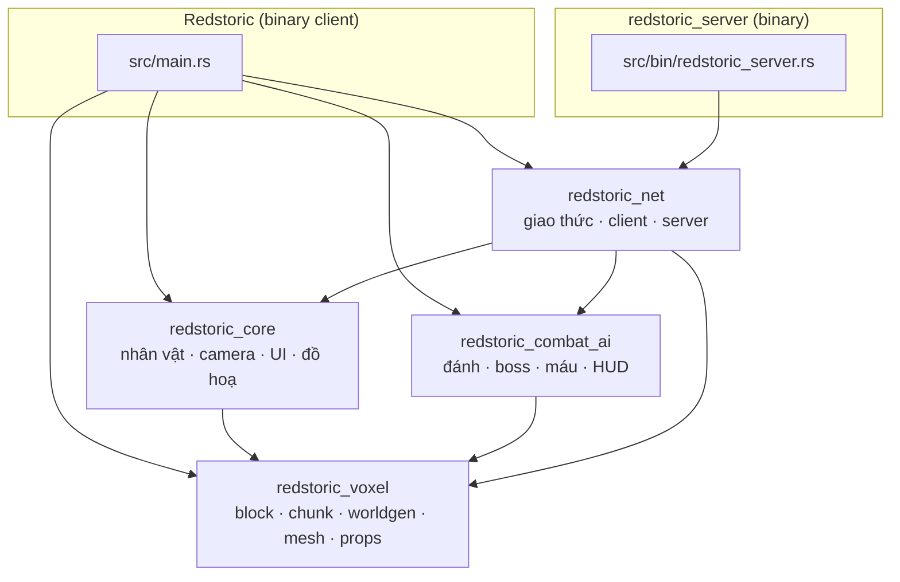
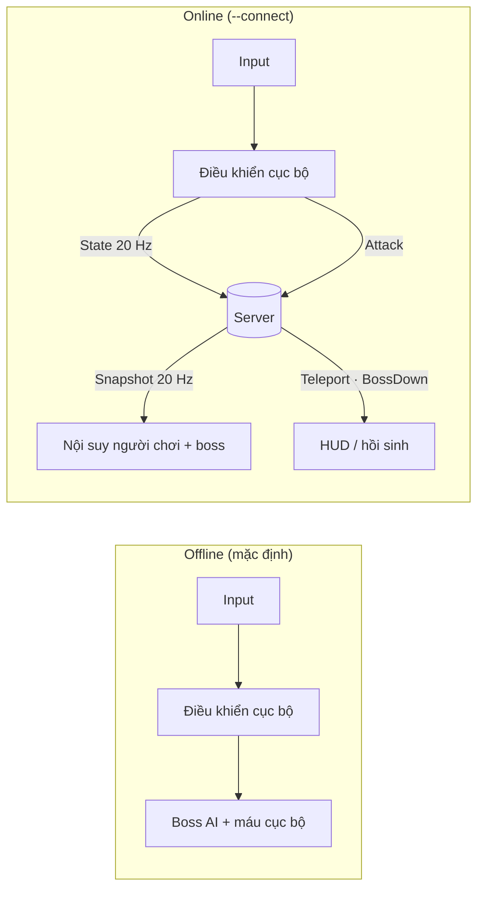
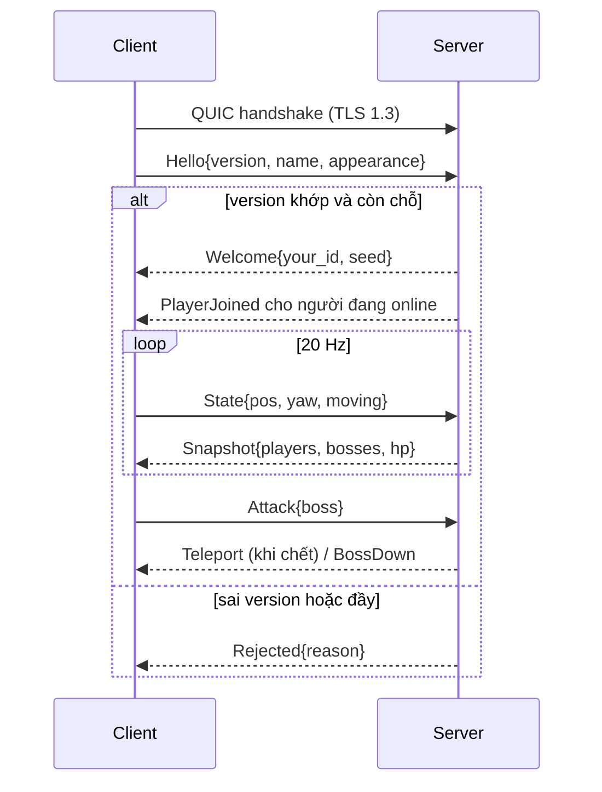

# Redstoric

Redstoric là một game voxel hành động viết bằng **Rust** và **Bevy 0.20**. Thế giới
được sinh thủ tục theo chunk, có làng, đấu trường boss, nhân vật tuỳ biến, combat
cận chiến và chế độ nhiều người chơi chạy trên **QUIC** với server có quyền quyết
định (authoritative) theo kiểu game co-op online.

> Dự án đang phát triển tích cực. Cấu trúc crate, giao thức mạng và định dạng dữ
> liệu có thể thay đổi giữa các phiên bản. Giao thức mạng hiện ở `PROTOCOL_VERSION = 1`.

---

## Mục lục

1. [Tính năng](#tính-năng)
2. [Bắt đầu nhanh](#bắt-đầu-nhanh)
3. [Điều khiển](#điều-khiển)
4. [Kiến trúc tổng quan](#kiến-trúc-tổng-quan)
5. [Hệ thống thế giới](#hệ-thống-thế-giới)
6. [Hệ thống chiến đấu và boss](#hệ-thống-chiến-đấu-và-boss)
7. [Nhân vật và hoạt ảnh](#nhân-vật-và-hoạt-ảnh)
8. [Đồ hoạ và hiệu năng](#đồ-hoạ-và-hiệu-năng)
9. [Hệ thống mạng](#hệ-thống-mạng)
10. [Cấu trúc thư mục](#cấu-trúc-thư-mục)
11. [Asset và công cụ](#asset-và-công-cụ)
12. [Cấu hình và file dữ liệu](#cấu-hình-và-file-dữ-liệu)
13. [Phát triển](#phát-triển)
14. [Hạn chế đã biết](#hạn-chế-đã-biết)
15. [Lộ trình](#lộ-trình)
16. [Giấy phép](#giấy-phép)

---

## Tính năng

| Nhóm | Nội dung |
| --- | --- |
| Thế giới | Chunk `16×64×16`, sinh bằng nhiều lớp noise (độ cao, khí hậu, hang động), 5 biome: Ocean, Desert, Savanna, Forest, SnowMountain |
| Cấu trúc | Làng (nhà, quảng trường, ruộng lúa/lúa mì/vườn), đấu trường boss, cây kiểu Veloren, hệ thống sprite trang trí đọc từ thư mục asset |
| Streaming | Sinh chunk trên worker thread, tải/dỡ theo khoảng cách người chơi, mesh có màu theo khối và ambient occlusion |
| Nhân vật | Dựng từ các mảnh model, trình tạo nhân vật (F7), hoạt ảnh đi bộ theo thủ tục |
| Chiến đấu | Đánh kiếm, kiểm tra trúng theo tầm và góc, knockback, hiệu ứng chớp đỏ, boss có máy trạng thái, HUD |
| Multiplayer | Server chuyên dụng (dedicated), tối đa 8 người, boss và máu do server quyết định, đồng bộ snapshot 20 Hz |
| Giao diện | Minimap, bộ đếm FPS, menu đồ hoạ với chế độ chất lượng tự động |
| Công cụ | `batch_vox`: chuyển `.vox` sang `.glb` |

## Bắt đầu nhanh

### Yêu cầu

- Rust stable hỗ trợ **Edition 2024**
- GPU/driver tương thích với backend WGPU của Bevy (Vulkan, DX12 hoặc Metal)
- Linux cần thêm thư viện hệ thống của Bevy (ALSA, udev, Wayland/X11); xem hướng
  dẫn dependency chính thức của Bevy

### Chơi một mình

```bash
cargo run --release
```

Build debug đã đặt `opt-level = 1`, nhưng `--release` vẫn nên dùng khi kiểm tra
streaming chunk và sinh mesh.

### Chơi nhiều người

Chạy server (cửa sổ terminal thứ nhất):

```bash
cargo run --release --bin redstoric_server -- --port 6000
```

Chạy client và kết nối (mỗi người chơi một terminal):

```bash
cargo run --release --bin Redstoric -- --connect 127.0.0.1:6000 --name Tam
```

Kết nối qua LAN/Internet: thay `127.0.0.1` bằng IP máy chạy server và mở
**UDP 6000** trên firewall/router (QUIC chạy trên UDP).

Có thể dùng biến môi trường thay cho tham số dòng lệnh:

| Tham số | Biến môi trường | Ý nghĩa | Mặc định |
| --- | --- | --- | --- |
| `--connect <ip[:port]>` | `REDSTORIC_SERVER` | Địa chỉ server; không đặt thì chơi offline | không |
| `--name <tên>` | `REDSTORIC_NAME` | Tên hiển thị (tối đa 20 ký tự) | tự sinh |
| `--port <port>` (server) | | Cổng lắng nghe | `6000` |

## Điều khiển

| Thao tác | Phím |
| --- | --- |
| Di chuyển | `W` `A` `S` `D` hoặc phím mũi tên |
| Nhảy | `Space` |
| Xoay camera | Giữ chuột phải + di chuyển chuột |
| Zoom | Con lăn chuột |
| Đánh | Chuột trái |
| Trình tạo nhân vật | `F7` |
| Bật/tắt FPS | `F3` |
| Đổi chế độ chất lượng | `F4` (Auto → Low → Medium → High → Ultra) |
| Menu đồ hoạ | `F10` |

## Kiến trúc tổng quan

Workspace gồm 4 crate và 2 binary:



| Crate | Trách nhiệm |
| --- | --- |
| `redstoric_core` | Điều khiển nhân vật, camera orbit, trình tạo nhân vật, hoạt ảnh, minimap, FPS, hệ thống đồ hoạ, material voxel |
| `redstoric_voxel` | Định nghĩa khối, chunk, bản đồ voxel, sinh địa hình, cấu trúc (làng, đấu trường), sprite/prop, dựng mesh, streaming |
| `redstoric_combat_ai` | Tấn công, kiểm tra trúng, máu người chơi, boss AI, hiệu ứng, HUD, bù nhìn tập đánh |
| `redstoric_net` | Giao thức `ClientMsg`/`ServerMsg`, plugin client, plugin server, đồng bộ trạng thái |

### Luồng chạy hai chế độ



Khi kết nối thành công, tài nguyên `OnlineMode(true)` tắt `boss_ai_system` và
`player_health_system` cục bộ. Đòn đánh trúng boss không gây sát thương tại
client mà được gom vào `PendingBossHits` rồi gửi lên server.

## Hệ thống thế giới

### Chunk và streaming

- Kích thước chunk: `16 × 64 × 16` (`CHUNK_SIZE_X/Y/Z`).
- Chunk được sinh bất đồng bộ trên worker thread rồi dựng mesh.
- Bán kính tải là 7 chunk; chunk bị dỡ khỏi scene khi vượt 9 chunk.
- Mesh lấy các mặt voxel lộ ra, tô màu theo loại khối, có ambient occlusion ở góc.

### Sinh địa hình

`WorldGenerator` là hàm thuần theo `WORLD_SEED` (hiện cố định `1337`), gồm:

- `surface`: độ cao địa hình từ nhiều tầng noise.
- `climate`: nhiệt độ và độ ẩm → biome (`Ocean`, `Desert`, `Savanna`, `Forest`, `SnowMountain`).
- `cave`: hang động.

Vì sinh thế giới là deterministic, server không cần tải chunk vẫn tìm được các
đấu trường boss bằng `WorldGenerator::sites_in_area`.

### Cấu trúc (Sites)

Thế giới chia thành các vùng; mỗi vùng có thể chứa một `Site`:

| Loại | Mô tả |
| --- | --- |
| `Village` | Quảng trường với trạm và đèn, nhà có nội thất, ruộng lúa/lúa mì/vườn kèm bù nhìn và rơm |
| `BossArena` | Đấu trường san phẳng, có phong ấn, nến, xương và mộ |

Địa hình quanh site được san phẳng và hoà trộn trong dải `BLEND = 6` khối.

### Props và sprite

- Cây sinh theo phong cách Veloren; prop được spawn theo chunk.
- Hệ thống sprite quét thư mục `assets/placeholders/glb/sprite`, dựng catalog tự
  động và đọc độ lệch chân từ accessor `min` của file glb.
- Bảng rải sprite theo biome: grassland, forest, savanna, desert, snow, beach.
  Thêm file glb mới vào thư mục sprite là đủ để hệ thống nhận ra.

## Hệ thống chiến đấu và boss

- **Đòn đánh**: chuột trái, kiểm tra trúng theo khoảng cách và góc nhìn, knockback,
  hiệu ứng chớp đỏ khi trúng.
- **Boss**: máy trạng thái `Idle → Chase → Windup → Recover → Dying`, giới hạn di
  chuyển trong bán kính 13 quanh tâm đấu trường, hồi sinh sau khi bị hạ.
- **Bù nhìn tập đánh**: 100 máu, mỗi đòn mặc định gây 25 sát thương trong tầm 2.8.
- **HUD**: thanh máu người chơi và boss.

Khi online, toàn bộ luật boss và máu chạy trên server.

## Nhân vật và hoạt ảnh

- Nhân vật dựng từ các mảnh model và ghép theo phân cấp; `clean_character_glb_hierarchy`
  chuẩn hoá cây node sau khi nạp glb.
- Trình tạo nhân vật (`F7`) lưu lựa chọn vào `character_appearance.json`.
- Hoạt ảnh đi bộ được tạo theo thủ tục (`biped_walk_animation_system`,
  `character_procedural_animation`), không cần clip dựng sẵn.
- Khi online, `appearance` của bạn được gửi cho server và phát cho người khác.

## Đồ hoạ và hiệu năng

- Chế độ chất lượng `Auto / Low / Medium / High / Ultra`; chế độ Auto tự điều
  chỉnh theo FPS. Cài đặt lưu vào `graphics_settings.json`.
- Menu đồ hoạ (`F10`), bộ đếm FPS (`F3`), minimap.
- Material voxel riêng và shader trong `assets/placeholders` / `assets/shaders`.

## Hệ thống mạng

### Tổng quan

- Thư viện: [`bevy_quinnet`](https://crates.io/crates/bevy_quinnet) **0.22** (dành cho Bevy 0.20), chạy trên Quinn/QUIC, TLS 1.3, tuần tự hoá bằng `bincode`.
- Mô hình: **server chuyên dụng có quyền quyết định**; client chỉ gửi ý định và vị trí, nhận trạng thái chuẩn.
- Giới hạn: tối đa **8** người chơi.

### Kênh

| ID | Kiểu | Dùng cho |
| --- | --- | --- |
| 0 | `OrderedReliable` | Hello, Welcome, Rejected, PlayerJoined/Left, Appearance, Teleport, BossDown, Attack |
| 1 | `Unreliable` | `State` của người chơi và `Snapshot` của server (20 Hz) |

### Thông điệp (`crates/redstoric_net/src/protocol.rs`)

```text
ClientMsg: Hello{version, name, appearance} | Appearance(String)
         | State(PlayerState{pos, yaw, moving}) | Attack{boss:[i32;2]}

ServerMsg: Welcome{your_id, seed} | Rejected{reason}
         | PlayerJoined{id, name, appearance} | PlayerLeft{id}
         | PlayerAppearance{id, appearance}
         | Teleport{pos} | BossDown{boss}
         | Snapshot{players, bosses, hp, max_hp}
```

### Trình tự kết nối



### Phân chia trách nhiệm

| Thành phần | Server | Client |
| --- | --- | --- |
| Máu người chơi | Sở hữu, trừ máu | Hiển thị |
| Boss (HP, AI, trạng thái) | Sở hữu, mô phỏng trên mặt phẳng XZ | Nội suy x/z, tự tính Y từ địa hình |
| Vị trí người chơi | Kiểm tra tốc độ tối đa | Sở hữu và gửi lên |
| Đòn đánh | Kiểm tra tầm (7.0) và hồi chiêu (0.3 s) | Gửi ý định `Attack` |
| Thế giới | Sinh từ `WORLD_SEED` để tìm đấu trường | Sinh và dựng mesh cục bộ |

### Bảo mật hiện tại

- Kênh được mã hoá bằng TLS 1.3. Server tạo chứng chỉ tự ký `server_cert.pem` / `server_key.pem` ở lần chạy đầu (đã nằm trong `.gitignore`).
- Client dùng `SkipVerification`: mã hoá được nhưng **không xác thực server**, nên chưa chống được tấn công man-in-the-middle. Đây là cấu hình dành cho phát triển và LAN.
- Server giới hạn kích thước appearance (1024 byte) và độ dài tên (20 ký tự), kiểm tra phiên bản giao thức.

## Cấu trúc thư mục

```text
.
├── assets/
│   ├── localization/            # Chuỗi dịch
│   ├── placeholders/
│   │   ├── glb/                 # Model glb (kèm glb/sprite cho sprite trang trí)
│   │   └── voxygen/voxel/       # Nguồn .vox
│   ├── shaders/
│   └── voxygen/                 # Asset tham khảo kiểu Veloren
├── crates/
│   ├── redstoric_core/          # Nhân vật, camera, UI, đồ hoạ
│   ├── redstoric_voxel/         # Voxel, worldgen, structures, sprites, mesh
│   ├── redstoric_combat_ai/     # Combat, boss, HUD
│   └── redstoric_net/           # Giao thức, client, server
├── src/
│   ├── main.rs                  # App client
│   └── bin/
│       ├── batch_vox.rs         # Công cụ .vox → .glb
│       └── redstoric_server.rs  # Server chuyên dụng
├── character_appearance.json    # Ngoại hình đã lưu
├── graphics_settings.json       # Cài đặt đồ hoạ đã lưu
└── Cargo.toml                   # Workspace
```

## Asset và công cụ

### Chuyển `.vox` sang `.glb`

```bash
cargo run --bin batch_vox
```

Quét `assets/placeholders/voxygen/voxel/`, ghi `.glb` vào `assets/placeholders/glb/`.
Tool xử lý model đầu tiên trong mỗi file `.vox`, bỏ mặt bị che, giữ màu palette.

### Thêm sprite trang trí

1. Đặt file `.glb` vào `assets/placeholders/glb/sprite/` (có thể chia thư mục con theo nhóm).
2. Chạy lại game; catalog tự quét, tự lấy độ lệch chân.
3. Muốn sprite xuất hiện ở biome nào thì thêm tên vào bảng tương ứng trong `crates/redstoric_voxel/src/sprites.rs`.

## Cấu hình và file dữ liệu

| File | Tạo bởi | Nội dung |
| --- | --- | --- |
| `character_appearance.json` | Trình tạo nhân vật (F7) | Ngoại hình nhân vật |
| `graphics_settings.json` | Menu đồ hoạ (F10/F4) | Chế độ chất lượng và tuỳ chọn |
| `server_cert.pem`, `server_key.pem` | Server, lần chạy đầu | Chứng chỉ TLS tự ký (không commit) |

## Phát triển

```bash
cargo fmt --all -- --check
cargo check --workspace
cargo test --workspace
```

Quy ước làm việc:

- Một thay đổi, một mục đích; mô tả rõ hành vi trong pull request.
- Giữ logic không phụ thuộc đồ hoạ (luật boss, worldgen) tách khỏi system Bevy để dễ chia sẻ giữa client và server.
- Mở issue trước với thay đổi lớn.
- Xoá các file `*.bak*` còn sót trước khi commit.

## Hạn chế đã biết

- Người chơi khác đang hiển thị bằng hình hộp tạm; ngoại hình được truyền nhưng chưa render.
- Chưa xác thực server (`SkipVerification`).
- Boss bị giới hạn bán kính 13 vì server không giữ voxel; chưa có va chạm địa hình phía server.
- `WORLD_SEED` cố định trong code, chưa cấu hình được.
- Boss đã hạ chỉ được nhớ trong một phiên server, chưa lưu xuống đĩa.
- Chưa có menu nhập địa chỉ server; dùng tham số dòng lệnh.
- Luật boss hiện được cài đặt ở hai nơi (`combat_ai/boss.rs` và `redstoric_net/server.rs`) với cùng hằng số.
- Chưa có lưu thế giới, chỉnh sửa khối đồng bộ, hay lag compensation.

## Lộ trình

1. Tách `redstoric_common` (không đồ hoạ): block, chunk, `WorldGenerator`, structures, luật chơi, giao thức.
2. Gộp luật boss thành hàm thuần dùng chung cho client và server.
3. Server nhúng cho chế độ chơi đơn (cùng một đường code với multiplayer).
4. Combat dựa trên sự kiện thay vì sửa máu trực tiếp.
5. Dữ liệu dạng file (RON/JSON): block, prop, boss, loot.
6. Lưu thế giới, đồng bộ chỉnh sửa khối, NPC dạng mô phỏng thế giới.
7. Đồng bộ delta theo vùng quan tâm, lịch sử vị trí cho lag compensation, đo thời gian tick.
8. Xác thực server bằng chứng chỉ thật, hiển thị nhân vật từ xa với ngoại hình đầy đủ.

## Giấy phép

Phát hành theo **GNU General Public License v3.0**. Xem [LICENSE](LICENSE).
